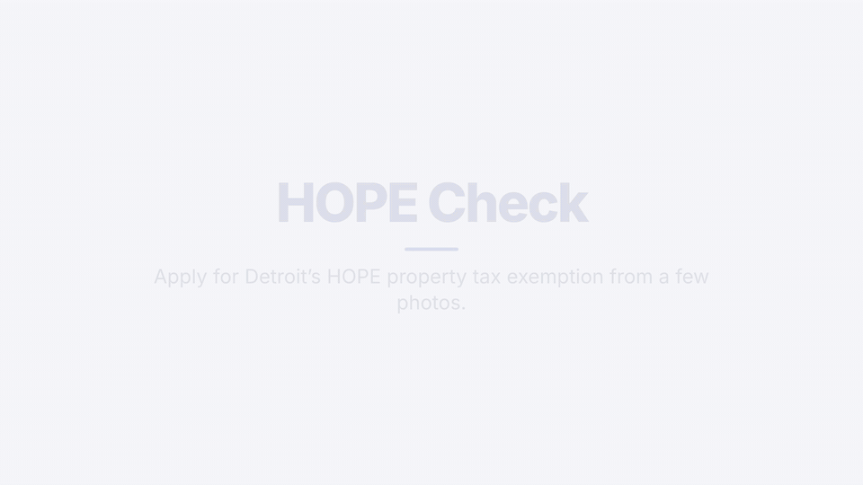

# HOPE Check



## Why this exists

Detroit's **HOPE** (Homeowners Property Exemption) can cut a low-income homeowner's property tax by 25% to 100%.
But applying means a 21-page PDF with about 230 fields, tax returns or affidavits for every adult, and a new
application every year. People who qualify miss out because the paperwork is hard, not because they aren't eligible.

HOPE Check turns that into a few photos and short questions on a phone, then fills in the City's official 2026
application for you.

## How it works

1. **Check if you can apply.** Five quick questions tell you if you likely qualify and how much you could save.
2. **Snap your documents.** Photos of your tax bill, W-2s, SSA-1099s, and bank and mortgage statements fill in most answers. Gemma 4 only reads the documents; tested rules decide eligibility.
3. **Answer a few short sections.** One question per page; "no" skips the follow-ups.
4. **Check your answers**, then **download the official 2026 HOPE application, filled in.** You sign it and submit it.

Nothing is stored on a server. Income limits, the $12,000 asset cap and the Nov 6, 2026 deadline come from the
City of Detroit's 2026 HOPE application. The Board of Review makes the final decision.

## Run it locally

```bash
npm install
cp .env.example .env.local   # MOCK_LLM=1 runs fully offline with sample answers
npm run dev                  # http://localhost:3000
```

| Variable | Meaning |
|---|---|
| `MOCK_LLM` | `1` = sample answers, no model calls (picked by filename: `tax-bill`, `detroit`, `ssa`, `w2`, `bank`, `mortgage`, `crop`) |
| `GEMINI_API_KEY` | Google AI Studio key (live mode) |
| `GEMMA_MODEL` | Exact Gemma 4 model id from AI Studio (live mode) |

Sample documents are in `public/samples/` and at `/samples`, including a real 2026 Detroit summer tax bill with the
parcel number blacked out (`detroit-summer-tax-bill-2026.jpg`).

`npm test` runs the unit tests. Every field the official PDF asks for, and how the app gets it, is listed in
[`docs/question-protocol.md`](docs/question-protocol.md). The full-quality demo video is
[`docs/demo/hope-check-demo.mp4`](docs/demo/hope-check-demo.mp4).
